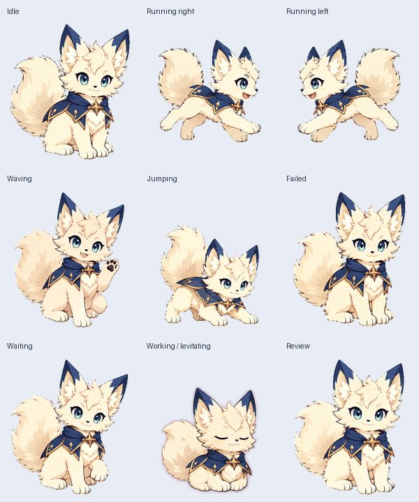
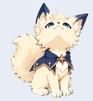

# GPTPets

Custom animated companion pets for ChatGPT Work mode.

## Lumi

Lumi is a cute anime moon fox with cream fur, teal eyes, a navy cape, and a gold star clasp. The design uses quadrupedal anatomy and a seated resting pose. A faint purple aura appears only while Lumi meditates and levitates.





The transparent v2 sprite sheet is **1536 × 2288 pixels**, arranged in **8 columns × 11 rows** with **192 × 208 cells**. It contains 73 populated frames: nine animation states plus sixteen look directions.

| Row | State | Frames |
| --- | --- | ---: |
| 0 | Idle | 6 |
| 1 | Running right | 8 |
| 2 | Running left | 8 |
| 3 | Waving | 4 |
| 4 | Jumping | 5 |
| 5 | Failed | 8 |
| 6 | Waiting | 6 |
| 7 | Working / levitating | 6 |
| 8 | Review | 6 |
| 9–10 | Looking around | 16 |

## Files

- `pets/lumi/final/`: final sprite sheet, animated previews, contact sheets, video, and pet record.
- `pets/lumi/artwork/`: canonical character reference.
- `pets/lumi/source-strips/`: selected generated animation and direction strips.
- `pets/lumi/frames/`: all 73 transparent final frames, grouped by state.
- `pets/lumi/prompts/`: artwork generation and repair prompts.
- `pets/lumi/qa/`: structural validation, visual direction reviews, quality checks, and Pets upload preflight.
- `pets/lumi/brief.md`: approved design and animation concepts.

The final sheet passed the bundled pet structural and quality gates, independent direction reviews, and Pets upload preflight. Some adjacent intermediate look angles have subtle differences, recorded as reviewed warnings. Earlier preview timing adjustments are not part of the upload format; the final previews use the Pets workflow's standard timing.

Lumi was created and selected in the owner's account. The stable pet ID is recorded for reference; cloning this repository does not install the pet in another account.

## Re-render previews

```sh
python3 -m pip install -r requirements.txt
python3 tools/preview_pet.py
```

This reads the existing sprite sheet and writes looping previews to `build/`. It does not generate new artwork, upload a pet, or replace the official validation workflow.

The large duplicate creation ZIP and temporary/rejected artwork are excluded. This repository preserves the selected art and supporting evidence directly.
